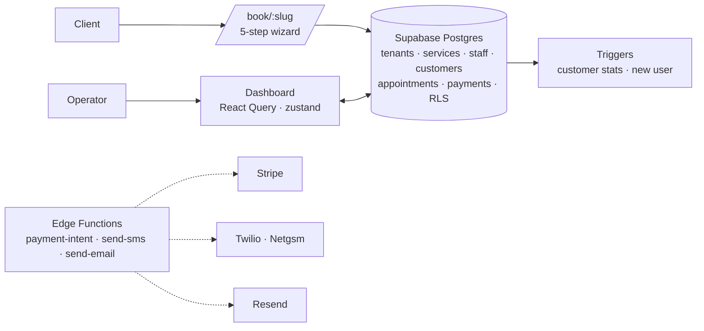

<div align="center">


<p>
  
  
  
  
</p>

<p><em>Bookings, clients, staff and payments for service businesses: a public booking page for clients<br>
and one dashboard for the people who run the chair, the studio or the clinic.</em></p>

</div>


## The idea

Hairdressers, barbers, tattoo studios, dietitians, beauty salons and physiotherapists all run on the same loop: a client wants a slot with a specific person, the business wants a full day without double bookings or no-shows. Appointify gives each business its own booking page at `/book/:slug` and an operator dashboard behind it, with every business's data walled off from the others.

> **One database, many businesses.** Every table carries a `tenant_id`, and row-level security policies (26 of them) only ever show a signed-in user their own business. The public booking page gets a narrow read of services, staff and taken slots, and can create a booking, nothing more.


## Features

| | |
|---|---|
| **Public booking page** | `/book/:slug` walks a client through five steps (service, staff, date and time, details, confirm) with step dots and a success screen. Slots already taken for that staff member are struck out. |
| **Dashboard** | Today's numbers, upcoming appointments, a status breakdown and a weekly revenue chart. |
| **Appointments** | List and calendar views, an add dialog, and a detail dialog to move an appointment through its six statuses: pending, confirmed, in progress, completed, cancelled, no-show. |
| **Customers** | A list with VIP / regular / new tags, visit count, total spend and no-show count, plus a detail sheet per client. Counters update when an appointment is completed. |
| **Services** | Price, duration and category for each service. |
| **Staff** | Team members with working hours and holidays. |
| **Payments** | Every payment with its appointment and customer. |
| **Booking rules** | Slot length, buffer between appointments, how far ahead and how soon a client may book, cancellation window, auto-confirm, whether clients pick staff, and an optional deposit percentage. |
| **Plans** | Solo, Team, Business and Enterprise, priced in USD and TRY, with staff, location, appointment and customer limits and a 14-day trial. |
| **TR / EN, dark and light** | i18next with browser language detection, `next-themes` for the theme. |


## Where it stands

Appointify is an MVP. The booking flow, the dashboard and the data model work end to end; some back-office pieces are in place on the server but not yet called from the app:

| Piece | State |
|---|---|
| Booking, appointments, customers, services, staff, payments, settings | Working, on Supabase with RLS |
| `check_availability` database function | Written; the booking page currently filters taken slots on the client |
| `payment-intent` Edge Function | Creates a Stripe payment intent when `STRIPE_SECRET_KEY` is set, otherwise returns a mock |
| `send-sms` · `send-email` Edge Functions | SMS through Twilio or Netgsm, email through Resend; reminders are not scheduled yet |
| WhatsApp reminders | Shown in settings as "soon" |


## How it fits together



| Plan | Staff | Locations | Appointments / mo | USD / mo | TRY / mo |
|---|---|---|---|---|---|
| Solo | 1 | 1 | 200 | 29 | 899 |
| Team | 5 | 1 | 500 | 49 | 1.499 |
| Business | 15 | 3 | 2,000 | 79 | 2.499 |
| Enterprise | unlimited | unlimited | unlimited | 149 | 4.999 |


## Pages

| Route | Page |
|---|---|
| `/` | Landing page |
| `/auth` | Sign in and sign up |
| `/book/:slug` | The business's public booking page |
| `/dashboard` | Overview |
| `/appointments` · `/customers` · `/services` · `/staff` · `/payments` | The operator screens |
| `/settings` | Business profile, booking rules, notifications |


## Türkçe özet

**Appointify**, kuaför, berber, dövme stüdyosu, diyetisyen, güzellik salonu ve fizyoterapist gibi hizmet işletmeleri için bir randevu ve müşteri yönetimi uygulaması. Müşteriler işletmeye özel `/book/:slug` sayfasından beş adımda randevu alıyor; işletme randevuları, müşterileri (VIP etiketi, ziyaret ve harcama sayıları), hizmetleri, personeli ve ödemeleri tek panelden yönetiyor. Her işletmenin verisi RLS ile ayrı tutuluyor. Proje MVP aşamasında: Stripe depozito, SMS ve e-posta fonksiyonları sunucuda hazır, uygulamaya bağlanması sırada.


## Development

```sh
npm install
cp .env.example .env
npm run dev          # Vite dev server
npm run type-check
npm run build
```

`.env` takes `VITE_SUPABASE_URL` and `VITE_SUPABASE_PUBLISHABLE_KEY` (or `VITE_SUPABASE_ANON_KEY`), plus `VITE_APP_URL`, `VITE_DEFAULT_LOCALE` and an optional `VITE_STRIPE_PUBLISHABLE_KEY`. The Edge Functions read their own secrets: `STRIPE_SECRET_KEY`, `RESEND_API_KEY`, `TWILIO_ACCOUNT_SID` / `TWILIO_AUTH_TOKEN` / `TWILIO_PHONE_NUMBER` or `NETGSM_USERCODE` / `NETGSM_PASSWORD` / `NETGSM_MSGHEADER`.

```
src/pages/            Landing, Auth, BookingPublic, Dashboard, Appointments, Customers, Services, Staff, Payments, Settings
src/components/       appointments, customers, dashboard, layout, shadcn/ui
src/hooks/            one React Query hook per table, plus useTenant and useStats
src/locales/          en and tr
supabase/migrations/  16 migrations: tables, RLS, functions and triggers
supabase/functions/   payment-intent, send-sms, send-email
```

Deployed as a static Vite build on Vercel with immutable asset caching and security headers.

<div align="center">
<br>
<a href="https://github.com/kutluhangil"></a>
<sub>Fewer no-shows, fuller days · the business and people in the banner are invented.</sub>
</div>
