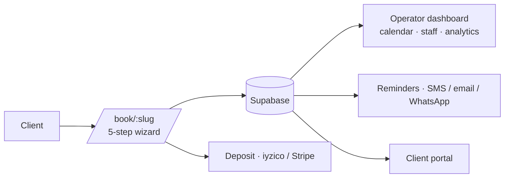

<div align="center">



<p>
  <a href="https://appointify-mu.vercel.app/"></a>
  
  
  
</p>

<p><em>Appointment management for hairdressers, barbers, tattoo studios, dietitians, beauty salons and physiotherapists,<br>
from a solo practitioner to a business with several locations.</em></p>

</div>


## What it is

Appointify gives service businesses a polished public booking page, an operator dashboard and a client portal in one product. Clients book themselves through a five-step wizard; the business sees the calendar, collects deposits to cut no-shows and sends reminders automatically.


## Features

| | |
|---|---|
| **Smart calendar** | Day, week and list views with automatic clash prevention. |
| **Booking widget** | A per-business `/book/:slug` page: service, staff, date, details, confirmation. |
| **Client portal** | Visit history, total spend, VIP tags and per-client bookings. |
| **Deposits** | Take a deposit online to reduce no-shows, with iyzico and Stripe. |
| **Reminders** | SMS, email or WhatsApp before each appointment, on a schedule you set. |
| **Staff** | Working hours, days off, specialties and performance per staff member. |
| **Service catalogue** | Price, duration and category, in Turkish and English. |
| **Analytics** | Weekly and monthly revenue, service mix, occupancy and average booking value. |
| **Settings** | Slot length, buffers, cancellation policy, deposit percentage, language and currency. |




## Türkçe özet

**Appointify**, kuaför, berber, dövme stüdyosu, diyetisyen, güzellik salonu ve fizyoterapist gibi hizmet işletmeleri için uçtan uca bir randevu ve müşteri portalı. Müşteriler işletmeye özel sayfadan beş adımda randevu alıyor; işletme takvimi, personeli ve gelir analizlerini tek panelden yönetiyor, online depozito ile gelmeyen müşteri sayısını azaltıyor ve otomatik hatırlatmalar gönderiyor.


## Development

```sh
npm install
npm run dev          # http://localhost:8080
npm test             # vitest
npm run type-check
npm run build
```

<div align="center">
<br>
<a href="https://github.com/kutluhangil"></a>
<sub>Fewer no-shows, fuller days.</sub>
</div>
